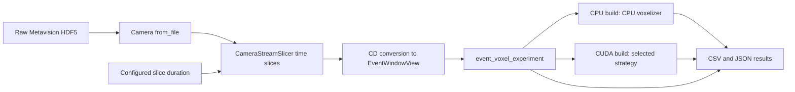

# Project map

One `event_voxel_experiment` invocation follows this path. The build selects
the CPU or CUDA branch.

The SDK slicer emits consecutive `[start_us, end_us)` CD windows, including
empty time slices where the SDK reports elapsed time. `EventWindowView`
borrows converted event memory until the next source read. The CPU voxelizer
defines the numerical result. `CudaExecutionSession` reuses buffers and a
stream across windows. Every invocation processes one file to the end and
writes a new result folder with source, build, and hardware metadata.

Every preset builds the HDF5 time-slice adapter and requires Metavision SDK
Stream. The experiment accepts HDF5 recordings; unit tests use hand-written
events to exercise voxelization. See
[streaming experiments](streaming-experiments.md) for the measurement contract.
