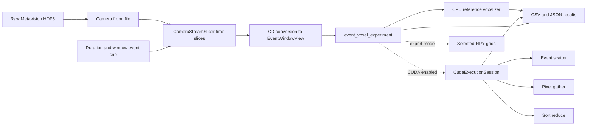

# Project map

One `event_voxel_experiment` invocation follows this path. Dashed arrows are
optional CUDA or export paths.

The SDK slicer emits consecutive `[start_us, end_us)` CD windows, including
empty time slices where the SDK reports elapsed time. The adapter checks a
per-window event cap. Its `EventWindowView` borrows converted event memory until
the next source read. The CPU voxelizer defines the
numerical result. `CudaExecutionSession` reuses buffers and a stream across
windows, so pipeline, transfer, strategy, and kernel timings have distinct
boundaries. All modes write a new result folder with source, build, and hardware
metadata.

Every preset builds the HDF5 time-slice adapter and requires Metavision SDK
Stream. The experiment accepts HDF5 recordings; unit tests use hand-written
events to exercise voxelization. See
[streaming experiments](streaming-experiments.md) for the measurement contract.
