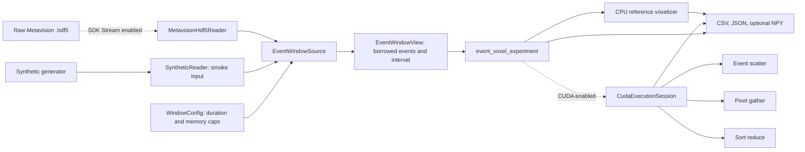
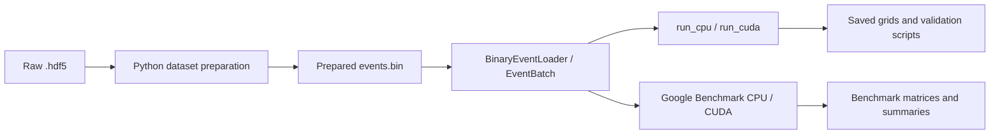

# Project map

This diagram follows one fixed-duration experiment from input to results. Arrows
mean "calls or supplies data to"; dashed arrows are optional build features.

| Part | Why it exists | Used by |
|---|---|---|
| `EventWindowSource` | Emits consecutive `[start_us, end_us)` windows, including empty gaps, while capping chunks and oversized windows. Its returned view lasts until the next `next()` call. | Experiment CLI; window tests; optional HDF5 integration test. |
| `MetavisionHdf5Reader` | Decodes original CD events directly from `.hdf5` through the optional SDK; keeps the SDK callback queue bounded. | `EventWindowSource` when `EVENT_VOXEL_ENABLE_METAVISION=ON`. |
| `EventWindowView`, `validate_window` | Shares a borrowed window contract between CPU and CUDA without copying event vectors. The owning `EventBatch` API adapts through `view_of` for older callers. | Both voxelizers; CUDA execution session. |
| CPU reference voxelizer | Defines the signed temporal interpolation result and supplies CPU paths and validation outputs. | Experiment CLI and older apps, benchmarks and tests. |
| `CudaExecutionSession` | Reuses device buffers and an explicit stream across windows; measures transfers, preparation, kernels and complete strategy stages. | Experiment CLI; the older `CudaVoxelizer` API wraps a session for one batch. |
| Three CUDA strategies | Alternative implementations of the same voxel grid calculation. | CUDA session; comparison and validation modes. |
| Experiment CLI | Controls windows, warmups, repetitions, scenarios, validation and export; saves `windows.csv`, `samples.csv`, `crossovers.csv`, `metadata.json` and `summary.json`. | Current fixed-duration studies and Nsight wrappers. |

The older workflow runs in parallel:

The `.bin` loader, one-shot apps, Google Benchmark executables and Python
scripts remain because committed validation and benchmark workflows still use
them. They do not feed the fixed-duration experiment. Raw recordings, prepared
binaries, exports and run folders are local data and are ignored by Git.

`CMakeLists.txt` always builds the common and CPU libraries. CUDA, direct HDF5
and Google Benchmark are separate options. Unit tests cover window boundaries
and CPU behavior; the HDF5 integration test is added only when the SDK and a
local recording are available. See [streaming experiments](streaming-experiments.md)
for timing boundaries and how to run each path.
